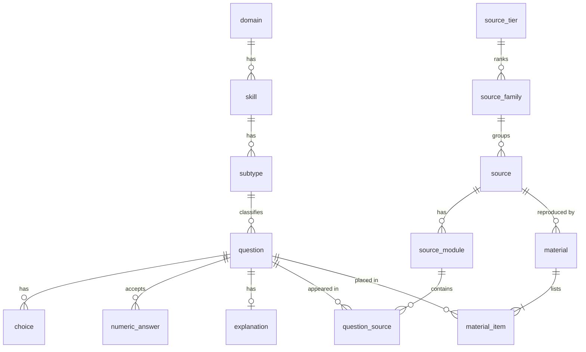

# 规范化题库（content/db）

`content/db/` 把题库存成一组符合第三范式的表：每道题只存一次，分类、来源、所在套题各有自己的表。它包含两类题：

- **已发布的题**（`status = published`，4,054 道）：和 `content/canonical/` 里的套题文件是同一份内容，两边由 `scripts/content_db.py` 互相生成，测试保证一致。其中 1,752 道是导入基线，2,302 道是从草稿发布的。
- **草稿题**（`status = draft`，3,265 道：读写 674、数学 2,591）：由 `scripts/import_question_bank.py` 从外部题库页面导入，只存在于表里，不在任何套题文件中，站点上看不到。第三方教辅的题不在表里，见“导入草稿题”。

站点构建器仍然只读取 `content/canonical/`。这套表没有改变任何页面、路由、`question_id` 或 `gradingRevision`。

## 表

每张表是一个 JSON Lines 文件：一行一条记录，键的顺序和 `schema.sql` 的列顺序相同，按主键排序。主键、外键和取值约束都在 [schema.sql](../content/db/schema.sql)。

| 表 | 主键 | 内容 | 行数 |
| --- | --- | --- | --- |
| `domain` | `domain_id` | 大类（领域）、所属科目、中文名称 | 9 |
| `skill` | `skill_id` | 题型，属于哪个大类 | 31 |
| `subtype` | `subtype_id` | 题型下的细分，照套题文件原样保存，名称不统一，只用于还原套题文件。`name` 为空的行表示"没有记录细分" | 148 |
| `task` | `task_id` | 细分题型：一个题型下面问法不同的几类，站点用的是这一张 | 40 |
| `passage_type` | `passage_type` | 文章类别：自然科学、历史与社会科学、人文艺术、小说、诗歌、戏剧、散文与回忆录 | 7 |
| `source_tier` | `tier` | 来源等级：1 真题、2 题库与练习套卷、3 第三方教辅；以及它算真题还是练习 | 3 |
| `source_family` | `family_id` | 来源系列，属于哪个等级 | 8 |
| `source` | `source_id` | 一份试卷、套卷或题库文件：名称、系列、年、月、地区 | 193 |
| `source_module` | `source_id` + `module_index` | 来源里的一个模块 | 314 |
| `question` | `question_id` | 文章、题干、答案、所属细分、状态、题型格式、难度及其依据、细分题型和文章类别及各自的依据 | 7,319 |
| `choice` | `question_id` + `label` | 选项文字、选项解析、选项图片地址 | 26,713 |
| `numeric_answer` | `question_id` + `position` | 填空题可接受的答案 | 884 |
| `explanation` | `question_id` | 解析 | 6,031 |
| `chart`、`question_visual` | | 已发布题目的题图和表格 | 47 / 186 |
| `question_source` | `source_id` + `module_index` + `number` | 一道题在某个来源的第几模块第几题 | 7,325 |
| `material` | `content_id` | 站点上的一份套题或专项 | 107 |
| `material_item` | `content_id` + `position` | 套题的第几题是哪道题 | 4,067 |
| `legacy_layout` | `layout_id` | 一条 canonical 记录里各个键的先后顺序 | 63 |



SQLite 强制执行的约束包括：

- 选择题的答案必须是这道题自己的选项之一；填空题没有选项答案，必须有 `numeric_answer`。
- 已发布的题必须是选择题，正文必须是站点的标记格式。
- 每道题指向一个存在的细分，细分指向题型，题型指向大类。
- 难度只能是 `easy`、`medium`、`hard` 或空；有难度就必须写明依据（`source_file` 或 `model`）。

## 视图

视图是算出来的，不存放数据。

| 视图 | 每行是什么 | 用途 |
| --- | --- | --- |
| `question_occurrence` | 一道题和它出现过的一个来源 | 显示题目的来源和年份 |
| `question_origin` | 一道题的最高来源等级、真题还是练习、在该等级来源中最近出现的年份 | 区分真题和模拟题 |
| `question_explanation` | 一道题的解析完整度：`full`（四段解析都写了，每个选项都有分析）、`brief`（写了一部分，通常只有一两句）、`none`（没有解析） | 区分有解析和没解析的题 |
| `question_importance` | 一道题的重要性：`core` 核心、`important` 重要、`basic` 基础，以及它在几场考试里出现过 | 按重要性选题 |
| `task_frequency` | 每个细分题型在真题里的题数和占比 | 看哪类题考得多 |
| `question_skill_conflict` | 细分题型所属的题型和套题文件里记录的题型不一致的题 | 待核对的分类 |
| `practice_pool` | 一道题的科目、大类、题型、细分题型、文章类别、真题或练习、年份、难度、重要性、解析完整度、状态 | 按范围选题、随机刷题 |

一道题既在真题里出现过、又在题库文件里出现过时，按真题算。

读写题的四个大类是 `domain` 表里的四行：信息与观点、技巧与构造、观点表达、标准英语用法。

```sh
python3 scripts/content_db.py sqlite
sqlite3 build/content.sqlite "SELECT domain_zh, kind, count(*) FROM practice_pool WHERE status = 'published' GROUP BY 1, 2"
```

`build/content.sqlite` 是生成物，不提交。

## 细分题型、文章类别和重要性

每道读写题都有这三项，数学题没有前两项。前两项由 `scripts/classify_questions.py` 写进 `question` 表，各带一列依据；重要性是视图，不存。

```sh
python3 scripts/classify_questions.py                     # 只看会改多少
python3 scripts/classify_questions.py --apply             # 写入 content/db/
python3 scripts/classify_questions.py --review-out 文件   # 列出还没有文章类别的文章
python3 scripts/classify_questions.py --review-in 文件 --apply   # 写入人工判定的类别
```

### 细分题型（`task_id`）

一个题型下面问法不同的几类，共 40 类，名称在 `task` 表。全部从题目本身读出来，不判断难度和内容，所以每次结果都一样：

| 题型 | 细分 | 依据 |
| --- | --- | --- |
| 词汇、结构与目的、双篇对比、主旨细节、文本证据、数据证据、推断 | 选词填空 / 词义理解，主要目的 / 整体结构 / 句子功能，观点回应 / 异同比较，主旨概括 / 细节理解，支持论点 / 削弱论点 / 引文例证，表格数据 / 图表数据，推断填空 / 推断理解 | 题干的问法，出题方只用固定的几种 |
| 笔记整合 | 对比异同、介绍概述、强调信息、解释说明、提出观点 | 题干里写明的写作目的 |
| 过渡词 | 转折对比、因果总结、补充递进、举例具体、强调重述、时间顺序、其他短语 | 正确答案那个过渡词的逻辑关系 |
| 标点 | 句号断句、分号、冒号、破折号与括号、逗号、无需标点 | 正确答案和其他选项相比多出来的那个标点 |
| 语法形式 | 主谓一致、动词时态、谓语与非谓语、代词、所有格与复数、修饰语与句子结构 | 四个选项之间变的是什么 |

题干或选项有时说明一道题记录的题型不对，比如选项全是代词的题被记在标点下面。这时细分题型跟着题目本身走，记录的题型不改（它来自套题文件）。这样的题有 39 道，在视图 `question_skill_conflict` 里；`practice_pool` 和站点的生成练习按细分题型所属的题型算。

### 文章类别（`passage_type`）

| 依据 | 含义 | 题数（读写 4,728 道） |
| --- | --- | --- |
| `source_intro` | 文章自己写明了体裁："The following text is from …'s 1899 novel …" 是小说，诗、剧同理；回忆录、随笔、非虚构著作的节选算散文与回忆录 | 350 |
| `word_list` | 说明文的用词明显属于某一类（脚本里的三张词表，领先不到 3 分不算） | 2,759 |
| `reviewed` | 词表拿不准，逐篇读过之后判定 | 1,619 |

词表有把握的部分抽查过：随机取 200 篇，不看词表结果另行判定，198 篇一致。词表拿不准的 1,357 篇全部逐篇判定；在这部分里词表的第一猜测只有 74% 和判定结果一致，所以没有直接采用。

三类说明文的界线：自然科学包括医学、技术、工程、数学、地理和环境；历史与社会科学包括经济、政治、法律、心理、语言、考古和各类历史；人文艺术包括美术、音乐、戏剧影视、建筑、文学研究和哲学。跨界的文章按它主要在讲什么来分，这一步有主观成分。

`reviewed` 的行脚本不会改；其余每次重算。还没有类别的读写题会让测试失败，所以新导入或新发布的题必须先分类。

### 重要性（视图 `question_importance`）

| 等级 | 条件 | 已发布题数 |
| --- | --- | --- |
| `core` 核心 | 真题，并且在两场及以上考试里出现过，或者出自题库里最近一个考试年份 | 345 |
| `important` 重要 | 其余真题 | 2,703 |
| `basic` 基础 | 练习题：分类题库、练习套卷，或来源未知 | 1,006 |

同一场考试的不同卷别只算一场。年份不明的真题不算最近。这是一条按来源算的规则，不是对题目本身的评价；要改规则只改这个视图。

`task_frequency` 给出每个细分题型在真题里的占比，目前最高的是选词填空（约 12.7%）和推断填空（约 7.5%）。

### 解析完整度

不存，由视图 `question_explanation` 从 `explanation` 和 `choice` 两张表算出，所以不会和解析内容对不上。目前已发布的 4,054 道题里：完整 1,752，简要 905，暂无 1,397。

构建站点时这几项都写进 `MANIFEST.questions`：`task`、`passageType`、`importance`、`examSittings`、`explanationLevel`；名称和顺序在 `MANIFEST.taxonomy`。`explanationLevel` 由构建脚本按同一规则从发布的题目内容算出，测试保证它和视图一致。

## 模考

`scripts/exam_modules.py` 从表里推出哪些真题套卷可以模考，并写进 `sat-content-registry.json` 的 `examEligible`、`moduleSpec`、`examVariants`：

- 只做读写。Module 1 加第二模块：来源标明 Harder 的用 Harder 那个，否则用它唯一的 Module 2；标明 Easier 的不用。两个模块固定，不做自适应分流，不给换算分。
- 题目按来源里的顺序排。没有发布的题（带图、标记不支持、近似重复）直接跳过，所以多数模块是 23–27 题；两个模块各自至少要有 22 题才开放。
- 时间按题量折算：27 题 32 分钟，向上取整到分钟。
- 注册表里手工配好 `m1` + `m2_hard` 的套卷原样开放，模块内容不改；如果手工模块里列了套卷已经没有的题，则保持关闭。

```sh
python3 scripts/exam_modules.py            # 列出可模考的套卷
python3 scripts/exam_modules.py --apply    # 写入注册表
python3 scripts/exam_modules.py --check    # 注册表和表不一致时失败
```

目前开放 19 套：18 套由表推出，1 套是手工配好的完整卷（27 + 27）。另有 16 套真题因收录题数不够没有开放。

## 页面数据里的来源和难度

`scripts/build-site.py` 构建时从表里取出每道已发布题目的来源和难度，交给构建器写进页面数据。只有套题文件、没有 `content/db/` 时站点照样能构建，这些字段为空值。草稿题不会出现在页面数据里。

| 首页 `MANIFEST.questions` | 练习页 `QUESTIONS` | 取值 |
| --- | --- | --- |
| `sourceKind` | `source_kind` | `"real_exam"`、`"practice"`，未知时为 `""` |
| `sourceTier` | `source_tier` | `1` 真题、`2` 题库与练习套卷、`3` 第三方教辅，未知时为 `null` |
| `sourceYear` | `source_year` | 在最高等级来源中最近出现的年份，未知时为 `null` |
| `difficultyLevel` | `difficulty_level` | `"easy"`、`"medium"`、`"hard"`，未知时为 `""` |
| `difficultyBasis` | `difficulty_basis` | `"source_file"` 来源写明、`"estimate"` 套题文件原有估计、`"model"` 模型估计，未知时为 `""` |
| `sourceRefs` | `source_refs` | 这道题出现过的来源，最好的排在最前；可能为空数组 |

`sourceRefs` 的每一项：`label`（来源名称）、`kind`、`tier`、`year`、`month`、`region`（`"apac"`、`"north_america"` 或 `""`）、`module`（模块名称，可能为 `""`）、`number`（在该来源中的题号，可能为 `null`）。

原有的 `difficulty`、`sourceSet`、`sourceFamily` 没有改动。这些字段不参与 `gradingRevision`。

页面显示来源时须保留"来源未经认证"的限定：`real_exam` 指回忆版真题，不是官方认证真题。

## 怎么改已发布的内容

两边都可以改，改完运行对应的命令，让另一边跟上，然后一起提交。

| 改了哪里 | 然后运行 |
| --- | --- |
| `content/canonical/` 里的套题文件 | `python3 scripts/content_db.py normalize` |
| `content/db/` 里的表 | `python3 scripts/content_db.py export` |

`python3 scripts/content_db.py check` 检查二者是否一致，`tests/test_content_db.py` 在 CI 里做同样的检查。

- 一道题出现在多份套题里时，直接改套题文件必须把每一份都改成一样，否则 `normalize` 会拒绝。改 `question.jsonl` 的一行再 `export` 更省事。
- 套题文件里出现表里没有的新字段时，`normalize` 会拒绝。先在 `schema.sql` 和脚本里给它加一列。
- `normalize` 和 `export` 不会改动草稿题。

## 导入草稿题

```sh
python3 scripts/import_question_bank.py --raw /题库页面所在的文件夹
```

导入的页面本身不进仓库。脚本做这些事：

- 把每个页面登记为一个来源，从标题里取出系列、年、月、地区。
- 合并内容相同的题。比较时忽略标签、空白、大小写和引号破折号的样式，保留标点和运算符。
- 认出已经发布的题：只给它补上来源记录，题目本身不改；题库文件写明难度时补上难度。
- 其余的作为草稿加入，分配新的题号（`bank_rw_…`、`bank_math_…`）。
- 文字相同但答案不同的题不合并，标记为需要人工复核。

第三方教辅（来源等级 3：BARRON'S Digital SAT、Digital SAT Prep Test、可汗）默认不导入。本仓库是公开的，表里不保留这些来源和只出自它们的题，`source_family` 里只留系列名称。要在本地导入须用 `--families` 写明系列，结果不要提交，`tests/test_content_db.py` 会拦住。

草稿题的分类依据记在 `skill_basis` 里：

| 取值 | 含义 |
| --- | --- |
| `curated` | 导入基线的题，沿用原有分类 |
| `source_file` | 来自按题型分类的题库文件，题型和难度取自文件标题 |
| `rule` | 仓库的规则打标工具给出的高置信度结果 |
| `model` | 模型阅读题目后给出的分类 |
| `none` | 还没有分类，挂在"未分类"下 |

草稿题的正文按原样保存。`markup = source_html` 的题带有 HTML 标签或远程图片地址，发布前要转换成站点的标记格式，并把图片下载登记到仓库里。

## 给读写题打标签

```sh
python3 scripts/label_questions.py export --work /仓库之外的工作文件夹
python3 scripts/label_questions.py merge  --work /仓库之外的工作文件夹 --apply
```

`export` 把没有难度的读写题切成每批 40 道的文件，并混入 300 道题库文件写明了题型和难度的题作为检验。标注者（模型或人）给每道题写出题型、难度和把握程度。`merge` 校验结果、打印和检验题的一致率，加上 `--apply` 才写回表里：

- 难度写入 `difficulty`，依据记为 `model`。
- 原先没有题型的题写入题型，依据记为 `model`。
- 已有题型的题不改，和标注不一致的只列在报告里。

2026-11 用轻量模型跑了一遍，在 300 道检验题上：题型 299 道一致；难度 156 道完全一致（52%），293 道相差不超过一档（98%），模型明显偏向标成 medium。所以 `difficulty_basis = model` 的难度只是粗略估计。

页面显示难度时的取值顺序：题库文件写明的难度，其次是套题文件原有的 `difficulty_estimate`，最后才是模型估计；`difficultyBasis` 字段说明用的是哪一种。

## 把草稿发布成套题

```sh
python3 scripts/publish_drafts.py --dry-run
python3 scripts/publish_drafts.py
```

一道读写草稿同时满足下面几条才会发布，否则保持草稿并在报告里说明原因：

- 四个选项的选择题，有题型，没有被标记为需要复核；
- 来源等级在允许范围内。默认只发布等级 1 和 2。第三方教辅（等级 3）不在仓库的表里，也不发布到这里；
- 正文能干净地转成站点标记：斜体、下划线、粗体转成标记，一张简单表格转成 `table_data`。带图片、上下标、合并单元格或非英文编者注的题不发布；
- 不是已发布题目或另一道待发布草稿的近似重复。近似重复而答案不同的两道题都不发布，列入报告。

每道题只进入一份新材料：真题按原卷建套题，分类题库按"题型 · 难度"建专项，不足 10 题的来源并入该系列的"补充题"专项。已有的套题文件不会被改动，题号沿用草稿的题号。新材料的 `sourceFamily` 是 `question-bank-import-unverified`（分类题库沿用 `SAT机考题库/skill-difficulty`）。

发布脚本不核对内容：答案和文字都是导入时的样子，解析只有来源自带时才有。2026-11 发布的 2,302 道题里有 1,397 道没有解析。逐题教学审核仍然需要另做。

## 有意保留的三处不彻底

- **表格和图表描述整体存成 JSON。** `table_data` 和 `visual_assets` 只用来显示，形状不统一，没有按单元格查询的需要。
- **`legacy_layout` 记录键的顺序。** `gradingRevision` 是对题目按原样序列化后求哈希，解析里各个键的顺序变了，哈希就会变。保留顺序才能让导出结果和现有文件逐字节相同。
- **`difficulty_estimate` 原样保留。** 它是已发布内容原有的字段，取值不统一。新的 `difficulty` 列只取 `easy`、`medium`、`hard`，目前只来自题库文件的标题。

## 还没有做的

- 题目正文仍然从 `content/canonical/` 构建；页面数据已带上来源和难度，但页面模板还没有用它们来筛选或显示。
- `sat-content-registry.json` 没有并入。
- 数学题全部是草稿，公式显示和填空判分没有做。
- 没有解析的已发布题，页面的解析区会显示空的小标题。
- 首页把全部题目的正文写进一个文件，题量增加后 `index.html` 约 7.7 MB。
